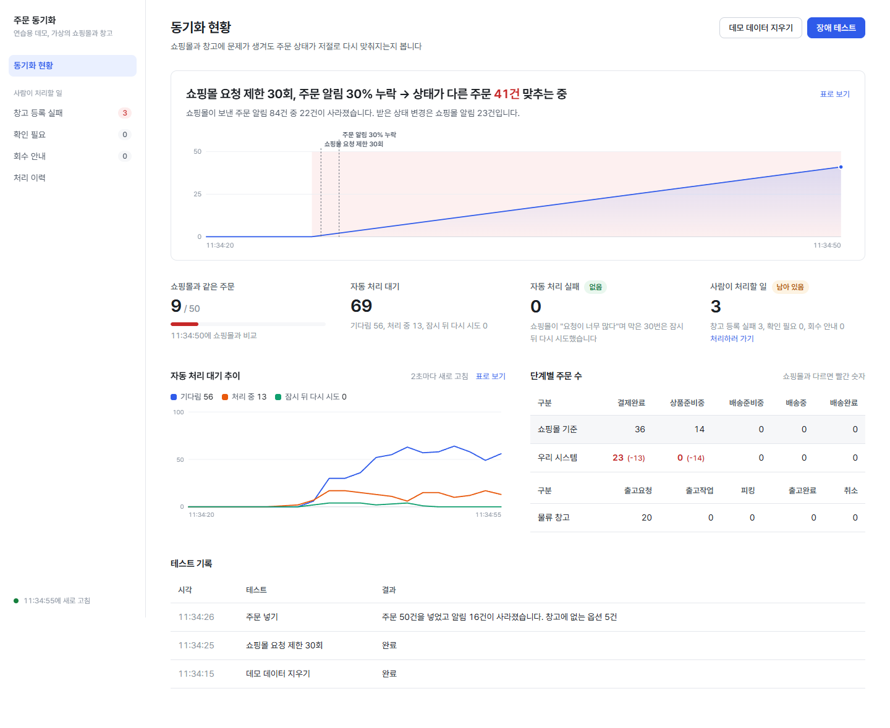
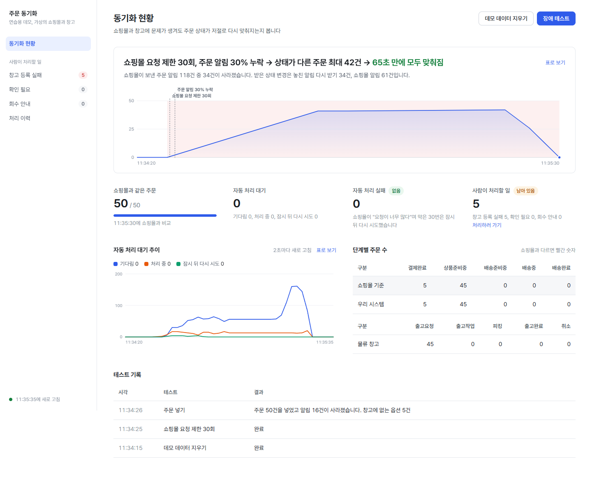
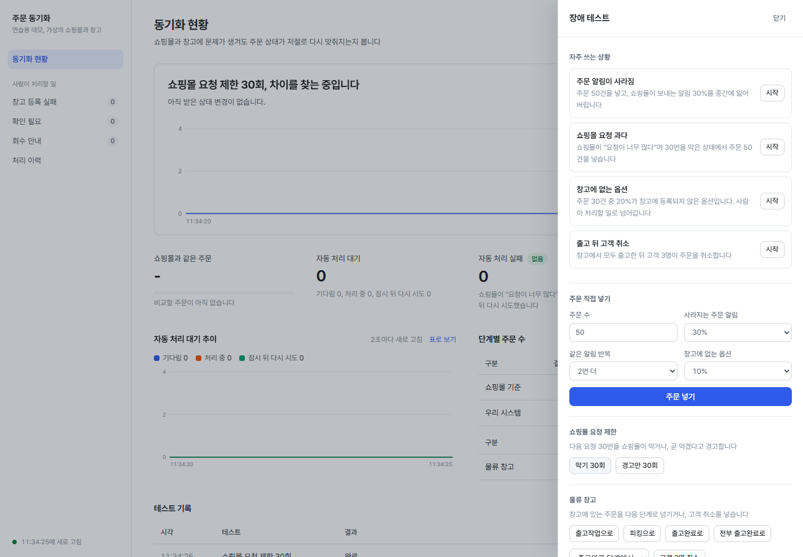
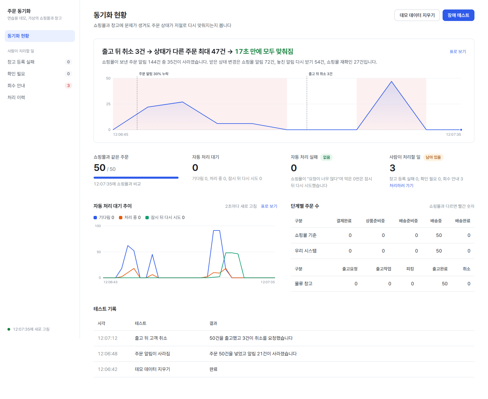

# order-fulfillment-sync

쇼핑몰(샵바이) 주문 상태와 3PL(파스토 규칙) 출고 상태를 맞추는 주문·출고 동기화 허브.

> **mock 기반 프로젝트입니다.** 실제 샵바이 서버 API는 앱 등록·심사가 필요해서 쓰지 않았습니다.
> 샵바이는 공개 OpenAPI 스펙과 웹훅 가이드, 파스토는 공개 연동 가이드의 규칙을 그대로 따르는 mock 서버(`mock-servers`)로 검증했습니다.
> 확인한 외부 동작과 mock이 가정한 동작은 [docs/references/external-facts.md](docs/references/external-facts.md)에 나눠 적었습니다.
> 성능·복구 수치는 모두 이 mock과 로컬 PC 기준의 실측값입니다 ([docs/measurements.md](docs/measurements.md)).

무엇을 왜 했고 어떤 문제를 풀었는지는 [docs/portfolio.md](docs/portfolio.md)에 정리했습니다.

## 풀려는 문제

| 문제 | 원인 | 이 프로젝트의 처리 |
|---|---|---|
| 웹훅 유실 | 샵바이는 실패한 웹훅을 재전송하지 않는다 | 실패 웹훅 조회 + STATUS_CHANGE 재조회 + 대사 배치 ([ADR-0002](docs/adr/0002-polling-is-source-of-truth.md)) |
| 웹훅 중복 | 같은 변경이 웹훅·실패 웹훅·재조회로 여러 번 들어온다 (이벤트 ID 없음) | 직접 만든 멱등 키를 DB UNIQUE로 ([ADR-0001](docs/adr/0001-idempotency-key-in-db.md)) |
| 순서 역전 | SQS Standard, 복구 경로의 늦은 도착 | 도착 순서 대신 상태 우선순위, 역전이는 conflict ([ADR-0003](docs/adr/0003-status-rank-ordering.md)) |
| 호출 제한 429 | 샵바이 초당 100회 토큰 버킷 | Redis 전역 토큰 버킷 80/s, 429는 재발행으로 DLQ에 보내지 않음 ([ADR-0007](docs/adr/0007-rate-limit-retry-by-republish.md)) |
| 취소·출고 경합 | 고객 취소 시 창고는 이미 작업 중 | 3PL 상태로 분기: 취소 / 배송보류 후 취소 / 이미출고+회수 안내 ([ADR-0005](docs/adr/0005-cancel-vs-shipment-flow.md), [ADR-0009](docs/adr/0009-cancel-state-machine-rules.md)) |
| 송장 일괄 반영 부분 실패 | by-shipping-no는 건별로 실패한다 | 실패한 배송만 다시 보냄 |
| 출고확정이 송장보다 먼저 옴 | 3PL 이벤트 순서 | 메시지 타이머로 지연 재처리, 초과 시 conflict + 묶음 알림 |

## 구조

```
inbound-api ─┐
worker ──────┼──▶ core ◀── infra          mock-servers (샵바이 mock, 3PL mock)
reconciler ──┤
admin-api ───┘
```

- `core`: 도메인 규칙(상태 우선순위, 멱등 키, 취소 상태 기계)과 포트. Spring·JPA·AWS 의존 없음
- `infra`: JPA·QueryDSL, SQS, Redis 레이트 리미터, 샵바이·3PL HTTP 어댑터
- `inbound-api`: 웹훅 수신 → 원본 저장 + outbox → SQS
- `worker`: 상태 반영, 출고 요청, 취소 처리, 3PL 이벤트, 송장 반영
- `reconciler`: 실패 웹훅 복구, STATUS_CHANGE 재조회, 대사 배치
- `admin-api`: CS 어드민 API (미연동·충돌·회수 목록, 재처리, 이력), 데모용 현황·대사 이력
- `frontend`: 데모 화면 (React + TypeScript + Vite). 장애 데모 대시보드와 CS 어드민
- 의존 규칙은 ArchUnit으로 검사합니다 ([ARCHITECTURE.md](ARCHITECTURE.md)).

설계 전체는 [docs/design-docs/order-sync-design.md](docs/design-docs/order-sync-design.md), 결정 이유는 [docs/adr/](docs/adr/README.md)에 있습니다.

## 실행

요구: Java 17, Docker.

```bash
docker compose up -d                 # MySQL 8.4, Redis 7.4, LocalStack 4.14(SQS)
./gradlew :mock-servers:bootRun      # 샵바이·3PL mock (8090)
./gradlew :inbound-api:bootRun       # 8081
./gradlew :worker:bootRun
./gradlew :reconciler:bootRun
./gradlew :admin-api:bootRun         # 8083
```

## 데모 화면

인프라, 앱 5개(`demo` 프로필: 재조회·대사 주기를 짧게), 프론트 개발 서버를 한 번에 띄웁니다. 요구: Node 20 이상, Docker 실행 중.

```bash
bash scripts/demo.sh                    # http://localhost:5173
MOCK_PORT=28090 FRONT_PORT=5180 bash scripts/demo.sh   # 포트를 다른 프로그램이 쓰고 있을 때
bash scripts/demo.sh stop               # 남은 앱 프로세스 정리
```


쇼핑몰 요청 제한 30회, 주문 알림 30% 누락, 같은 알림 2번 더, 창고에 없는 옵션 10%를 걸고 주문 50건을 넣었습니다. 실제로는 85초 걸린 과정을 약 8배 빠르게 돌렸습니다. 로컬 PC와 mock 기준입니다.

화면 문구는 운영자 말로 썼습니다. 원래 기술 용어는 마우스를 올리면 보입니다. 예를 들어 "자동 처리 실패"에 올리면 "DLQ"가 보입니다.

**동기화 현황**: "장애 테스트"로 문제 상황을 만들고, 주문 상태가 다시 맞춰지는 과정을 봅니다.
- 자주 쓰는 상황
  - 주문 알림이 사라짐 (웹훅 유실)
  - 쇼핑몰 요청 과다 (429)
  - 창고에 없는 옵션 (3PL 미연동)
  - 출고 뒤 고객 취소
- 직접 조합할 수도 있습니다.
- 복구 과정 그래프: 쇼핑몰과 비교(대사)할 때마다 상태가 다른 주문 수를 그립니다.
  - 장애를 일으킨 시점은 세로선, 상태가 달랐던 구간은 옅은 빨강으로 표시합니다.
  - 그래프 위에 "쇼핑몰 요청 제한 30회, 주문 알림 30% 누락 → 상태가 다른 주문 최대 42건 → 65초 만에 모두 맞춰짐" 같은 요약이 붙습니다.
- 지표: 쇼핑몰과 같은 주문, 자동 처리 대기, 자동 처리 실패, 사람이 처리할 일
- 단계별 주문 수: 쇼핑몰 기준과 우리 시스템을 나란히 보여 주고, 다르면 빨간 숫자로 표시합니다.

**사람이 처리할 일**: 시스템이 스스로 풀지 못한 주문을 봅니다. 창고 등록 실패, 확인 필요, 회수 안내, 처리 이력으로 나눕니다.
- 창고 등록 실패는 골라서 창고에 다시 등록합니다. 건마다 `Idempotency-Key`를 새로 만들어 보냅니다.
- 확인 필요는 사유와 함께 운영자가 할 일을 보여 줍니다.

캡처 조건: 쇼핑몰 요청 제한 30회를 건 뒤 주문 50건을 넣었습니다(알림 30% 누락, 같은 알림 2번 더, 창고에 없는 옵션 10%). 로컬 PC와 mock 기준입니다.
같은 조건으로 여러 번 돌리면 다시 맞춰지기까지 38초에서 136초가 걸렸습니다.

| 맞추는 중 | 모두 맞춰짐: 자동 처리 실패 0, 확인 필요 0 |
|---|---|
|  |  |

| 장애 테스트 | 창고 등록 실패 목록 |
|---|---|
|  |  |

주문 알림 누락에 이어 "출고 뒤 고객 취소"까지 넣어도 다시 맞춰집니다.
- 이미 배송중인 주문 3건이 취소되면 이미출고로 처리합니다.
- 우리 쪽 취소 정보도 지우고, 회수 안내 3건만 사람에게 남깁니다 ([ADR-0012](docs/adr/0012-apply-already-delivery-result.md)).



창고 옵션 설정을 고친 뒤 5건을 창고에 다시 등록했습니다. 1건은 직접 해결했고, 4건은 자동 재시도가 먼저 끝내 "이미 해결됨"으로 나왔습니다 ([캡처](docs/images/demo-admin-reprocessed.png)).

화면 생김새를 정한 근거는 [docs/design-docs/demo-ui-references.md](docs/design-docs/demo-ui-references.md)에 있습니다. Tremor 대시보드 템플릿, Vercel Observability, Anthropic frontend-design 스킬을 참고했습니다.

```bash
cd frontend && npm test                 # 화면 단위 테스트 (vitest, API는 가짜 fetch)
```

## 테스트와 측정

```bash
./gradlew check                       # 컴파일, 단위 테스트, ArchUnit (빠른 검사)
./gradlew :scenario-tests:scenarioTest   # 시나리오 F-02~F-13 (Testcontainers로 전체 모듈을 한 JVM에서 띄움)
./gradlew :scenario-tests:measure        # 장애 주입·부하 측정 (k6 필요) → scenario-tests/build/measurements/
```

기능 목록과 검증 테스트는 [feature_list.json](feature_list.json)에 있습니다. 각 기능은 해당 시나리오 테스트가 통과했을 때만 완료로 표시합니다.

## 범위 밖과 알려진 한계

- 실제 샵바이·파스토 연동, 실제 Slack 발송(알림은 `notification` 테이블까지), 재고·반품·교환, 클라우드 배포, 일반 사용자용 프론트엔드 (데모 화면만 있음)
- CS 어드민 인증: 처리자를 `X-Actor` 헤더로 받습니다. 위조할 수 있으므로 이력의 "누가"는 신뢰할 수 없습니다(인증은 범위 밖).
- 확인하지 못한 외부 동작은 [external-facts.md](docs/references/external-facts.md)의 "확인하지 못한 것"에 있습니다.
- "여러 인스턴스"는 한 JVM의 Spring 컨텍스트 여러 개로 흉내 냈습니다. 별도 프로세스로는 검증하지 않았습니다.

## 개발 방식

이 저장소는 AI 코딩 에이전트(Claude Code)와 함께 개발했습니다. 에이전트가 지킬 규칙과 검사 장치(문서 lint, 수정 범위 검사, Stop 훅, ArchUnit, 기능별 시나리오 테스트, 별도 컨텍스트 리뷰)는 [docs/harness/harness-design.md](docs/harness/harness-design.md)에 있습니다.
