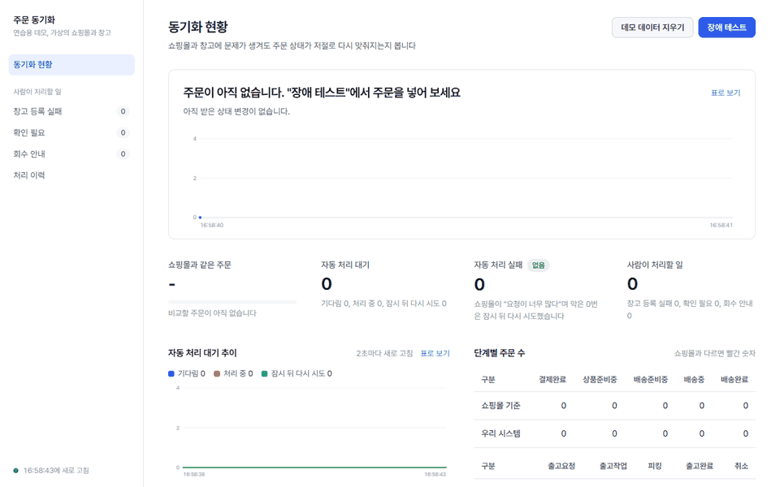
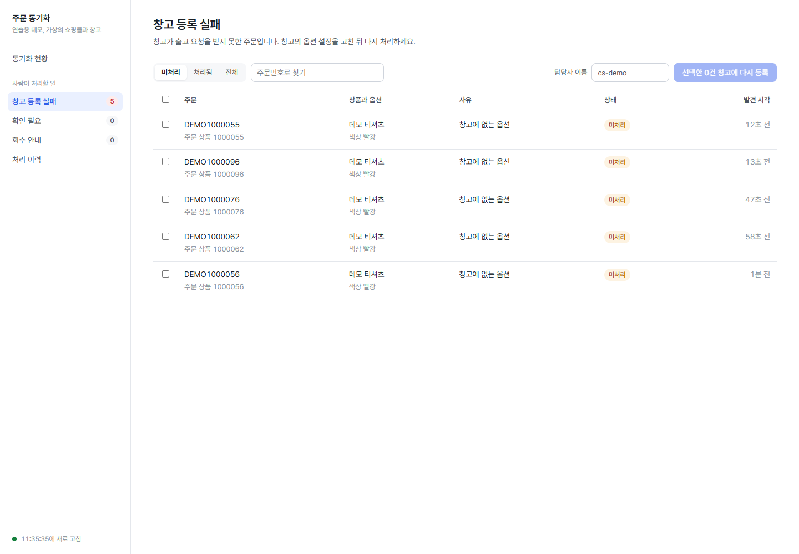

# order-fulfillment-sync

샵바이 쇼핑몰의 주문 상태와 3PL 창고(파스토 방식)의 출고 상태를 맞춰 주는 동기화 서버입니다.



주문 50건을 넣으면서 일부러 장애를 걸었습니다. 주문 알림 30%를 버리고, 쇼핑몰 요청 30번을 막고, 같은 알림을 두 번씩 더 보내고, 창고에 없는 옵션을 10% 섞었습니다. 상태가 다른 주문이 44건까지 늘었다가 85초 만에 0이 됐습니다. 창고에 없는 옵션 7건처럼 시스템이 스스로 풀 수 없는 건만 사람이 볼 목록에 남습니다.

영상은 약 8배 빠르게 돌렸습니다. 데모는 재조회 주기를 짧게 줄인 설정이고, 같은 조건으로 돌려도 38초에서 136초까지 차이가 났습니다.

실제 샵바이 API는 앱 등록과 심사가 필요해서 쓰지 않았습니다. 대신 샵바이 공개 OpenAPI 스펙과 웹훅 가이드, 파스토 공개 연동 가이드를 따르는 mock 서버로 검증했습니다. 문서에서 확인한 동작과 mock이 가정한 동작은 [external-facts.md](docs/references/external-facts.md)에 나눠 적었습니다.

## 무엇이 어려운가

샵바이 웹훅은 실패해도 다시 보내 주지 않습니다. 그래서 웹훅만 믿으면 주문 상태가 조용히 어긋납니다. 이 서버는 웹훅을 빠른 신호로만 쓰고, 실패한 웹훅 조회와 상태 변경 재조회, 하루 한 번 대사로 빠진 변경을 다시 가져옵니다 ([ADR-0002](docs/adr/0002-polling-is-source-of-truth.md)).

그러다 보니 같은 변경이 여러 경로로 여러 번 들어옵니다. 샵바이 웹훅에는 이벤트 ID가 없어서 주문 옵션, 상태, 클레임, 시각으로 키를 직접 만들고 DB UNIQUE로 한 번만 반영합니다 ([ADR-0001](docs/adr/0001-idempotency-key-in-db.md)). 큐(SQS Standard)는 순서를 지키지 않고 복구 경로로 들어온 변경은 늦게 도착하기도 해서, 도착 순서 대신 상태 순위로 판단합니다 ([ADR-0003](docs/adr/0003-status-rank-ordering.md)). 샵바이 호출은 초당 100회로 제한되므로 Redis 토큰 버킷으로 어느 1초 구간에서도 80회를 넘지 않게 하고, 그래도 429가 오면 큐에 다시 넣습니다 ([ADR-0007](docs/adr/0007-rate-limit-retry-by-republish.md)).

가장 까다로운 건 취소입니다. 고객이 취소했을 때 창고는 이미 상품을 고르거나 포장하고 있을 수 있습니다. 창고 상태를 보고 바로 취소하거나, 출고를 멈춘 뒤 취소하거나, 이미 나갔으면 회수를 안내합니다 ([ADR-0005](docs/adr/0005-cancel-vs-shipment-flow.md), [ADR-0009](docs/adr/0009-cancel-state-machine-rules.md), [ADR-0012](docs/adr/0012-apply-already-delivery-result.md)).

문제를 하나씩 어떻게 풀었는지와 측정 결과는 [docs/portfolio.md](docs/portfolio.md)에 정리했습니다.

## 직접 돌려 보기

Java 17, Docker, Node 20 이상이 필요합니다. 아래 명령 하나로 인프라, 앱 5개, 화면을 띄웁니다.

```bash
bash scripts/demo.sh
```

화면은 http://localhost:5173 에 뜹니다. 포트가 이미 쓰이고 있으면 `MOCK_PORT=28090 FRONT_PORT=5180 bash scripts/demo.sh`처럼 바꿀 수 있습니다. 끝나면 `bash scripts/demo.sh stop`으로 정리합니다.

"장애 테스트"에서 장애를 고르고 주문을 넣으면, 상태가 다시 맞춰지는 과정이 그래프로 보입니다. "사람이 처리할 일"에는 창고 등록 실패나 확인이 필요한 주문만 모입니다.



앱을 하나씩 띄우려면 이렇게 합니다.

```bash
docker compose up -d                 # MySQL 8.4, Redis 7.4, LocalStack(SQS)
./gradlew :mock-servers:bootRun      # 샵바이·3PL mock (8090)
./gradlew :inbound-api:bootRun       # 8081
./gradlew :worker:bootRun
./gradlew :reconciler:bootRun
./gradlew :admin-api:bootRun         # 8083
```

## 구조

```
inbound-api ─┐
worker ──────┼──▶ core ◀── infra          mock-servers (샵바이 mock, 3PL mock)
reconciler ──┤
admin-api ───┘
```

웹훅은 `inbound-api`가 받아 원본과 outbox에 저장한 뒤 바로 응답하고, 실제 반영은 `worker`가 SQS에서 꺼내 처리합니다. `reconciler`는 빠진 변경을 다시 가져오고 대사를 돌립니다. `admin-api`는 사람이 처리할 일을 보여 주는 CS 화면용 API입니다. 도메인 규칙은 Spring이나 JPA에 의존하지 않는 `core`에 두고, 모듈 간 의존 규칙은 ArchUnit으로 검사합니다 ([ARCHITECTURE.md](ARCHITECTURE.md)).

설계 전체는 [order-sync-design.md](docs/design-docs/order-sync-design.md)에, 결정 이유는 [docs/adr/](docs/adr/README.md)에 있습니다.

## 테스트

```bash
./gradlew check                          # 단위 테스트, ArchUnit
./gradlew :scenario-tests:scenarioTest   # 전체 모듈을 한 JVM에 띄운 시나리오 테스트 (Testcontainers)
./gradlew :scenario-tests:measure        # 장애 주입·부하 측정 (k6 필요)
cd frontend && npm test                  # 화면 단위 테스트
```

기능 목록과 각 기능을 검증하는 테스트는 [feature_list.json](feature_list.json)에 있습니다. 측정 조건과 결과는 [measurements.md](docs/measurements.md)에 있고, 모두 mock과 로컬 PC 기준입니다.

## 하지 않은 것

실제 샵바이·파스토 연동, 실제 Slack 발송, 재고·반품·교환, 클라우드 배포는 범위 밖입니다. 알림은 `notification` 테이블에 쌓는 데까지만 합니다.

CS 화면의 처리자는 `X-Actor` 헤더로 받습니다. 인증이 없어서 이력에 남는 "누가"는 믿을 수 없습니다. 여러 인스턴스 동작은 한 JVM 안에 Spring 컨텍스트를 여러 개 띄워 흉내 냈고, 별도 프로세스로는 확인하지 않았습니다.

## 개발 방식

AI 코딩 에이전트(Claude Code)와 함께 개발했습니다. 에이전트가 지켜야 할 규칙과 그걸 검사하는 장치는 [harness-design.md](docs/harness/harness-design.md)에 있습니다.
