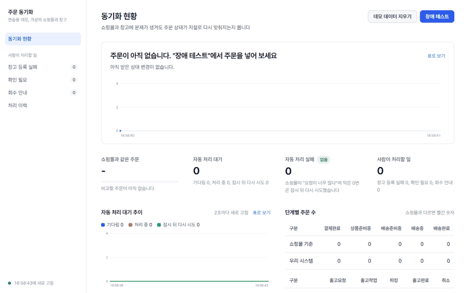
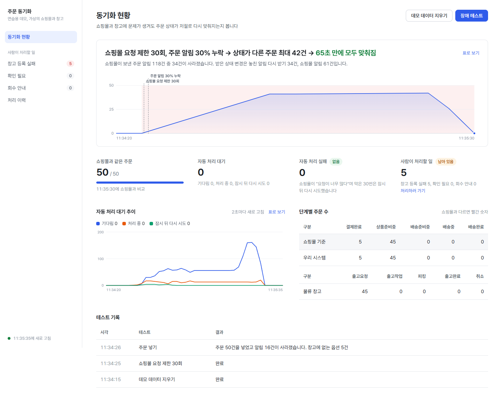
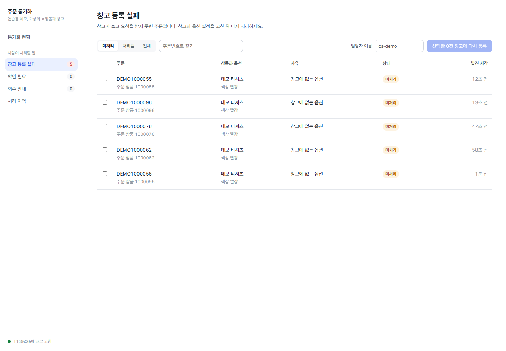

# 주문·출고 동기화 허브

쇼핑몰(샵바이) 주문 상태와 3PL 창고 출고 상태가 어긋나지 않게 맞추는 백엔드입니다.
웹훅이 사라지고, 중복되고, 순서가 바뀌고, API가 429를 내도 불일치가 0으로 돌아오는지를 장애를 직접 넣어 확인했습니다.
- 실제 외부 시스템이 아니라 공개 스펙을 따르는 mock과 로컬 PC에서 확인했습니다.
- 같은 측정은 1~2번 돌렸습니다.

- 저장소: [README](../README.md)
- 기간: 2026-11-11 ~ 2026-11-12, 1인 개인 프로젝트 (AI 코딩 에이전트 Claude Code와 함께 개발)
- 스택: Java 17, Spring Boot 3.5, JPA·QueryDSL, MySQL 8.4, Redis 7.4, SQS(LocalStack), Gradle 멀티모듈, Testcontainers, k6, React + TypeScript(데모 화면)
- 전제: 실제 샵바이·파스토 API는 쓰지 않았습니다. 공개 스펙과 가이드의 규칙을 따르는 mock 서버로 검증했습니다 ([external-facts.md](references/external-facts.md)).

넣은 장애는 쇼핑몰 요청 제한 30회, 주문 알림 30% 누락, 같은 알림 2번 더, 창고에 없는 옵션 10%이고, 주문은 50건입니다.
- 상태가 다른 주문이 최대 44건까지 늘었다가 85초 만에 0이 됐습니다.
- 창고에 없는 옵션 7건은 자동으로 풀 수 없어 "사람이 처리할 일"에 남았습니다.
- 데모는 복구 주기를 짧게 줄인 설정입니다(재조회 15초, 실패 알림 조회 10초). 운영 설계는 각각 5분, 10분입니다.
- 한 번 녹화한 값입니다. 같은 조건에서도 실행마다 달라 136초 걸린 적도 있습니다. 영상은 약 8배 빠르게 돌렸습니다.

## 1. 풀려는 문제

쇼핑몰 주문이 창고로 넘어가고 송장이 쇼핑몰로 돌아오는 사이에 상태가 어긋납니다.

| 상황 | 그대로 두면 |
|---|---|
| 샵바이는 실패한 웹훅을 다시 보내지 않는다 | 결제된 주문이 창고로 넘어가지 않는다 |
| 같은 변경이 웹훅, 실패 웹훅 조회, 재조회로 여러 번 온다. 이벤트 ID가 없다 | 창고에 두 번 등록하거나 상태를 되돌린다 |
| 메시지 순서가 바뀐다 (SQS Standard, 늦게 도착하는 복구 경로) | 배송중인 주문이 결제완료로 돌아간다 |
| 샵바이 API는 초당 100회 제한이고, 넘으면 429 | 재처리가 몰리면 실패가 DLQ에 쌓인다 |
| 고객이 취소했는데 창고는 이미 작업 중이다 | 취소된 주문이 출고된다 |

목표는 이 상황을 **일부러 만들어도** 불일치가 0으로 돌아오고, 사람이 봐야 하는 건만 CS 화면에 남는 것입니다.

## 2. 핵심 설계

| 결정 | 이유 | 문서 |
|---|---|---|
| 웹훅은 신호일 뿐이고, 최종 기준은 주문 조회 API다. 실패 웹훅 조회(10분), 상태 변경 재조회(5분), 대사 배치(하루 1회)로 복구하고 확인한다 | 웹훅은 유실된다. 실패 내역에 남지 않는 유실도 있을 수 있다(실제 샵바이에서는 미확인) | [ADR-0002](adr/0002-polling-is-source-of-truth.md) |
| 멱등 키를 직접 만들어 DB UNIQUE로 막는다 | 이벤트 ID가 없고, 출처가 다른 같은 변경은 큐가 걸러 주지 못한다 | [ADR-0001](adr/0001-idempotency-key-in-db.md) |
| 도착 순서 대신 상태 우선순위로 반영하고, 되돌아가는 변경은 conflict로 남긴다 | SQS Standard는 순서를 보장하지 않는다 | [ADR-0003](adr/0003-status-rank-ordering.md) |
| Redis 전역 토큰 버킷을 초당 80회로 두고, 429는 다시 발행한다. DLQ로 보내지 않는다 | 429는 실패가 아니라 기다리라는 신호다 | [ADR-0004](adr/0004-global-rate-limiter.md), [ADR-0007](adr/0007-rate-limit-retry-by-republish.md) |
| 취소는 3PL 단계로 나눈다: 바로 취소 / 배송보류 후 취소 / 이미출고와 회수 안내 | 창고가 어디까지 진행했느냐에 따라 할 수 있는 일이 다르다 | [ADR-0005](adr/0005-cancel-vs-shipment-flow.md), [ADR-0009](adr/0009-cancel-state-machine-rules.md) |

웹훅 수신은 원본 저장과 outbox까지만 하고 바로 응답합니다. 반영은 worker가 SQS에서 꺼내 처리합니다.
- 모듈은 `inbound-api`, `worker`, `reconciler`, `admin-api`가 `core`(도메인 규칙, Spring 의존 없음)를 쓰는 구조입니다.
- 의존 방향은 ArchUnit으로 검사합니다.

## 3. 문제 해결 사례

### 3-1. 실패 웹훅 조회만으로는 부족한 경우를 재현했다

- **상황:** 실패 웹훅 조회만으로 복구된다고 보기 쉽습니다. 하지만 샵바이 실패 내역에 남지 않는 유실도 있을 수 있습니다. 실제 샵바이에서 이런 유실이 일어나는지는 확인하지 못했습니다.
- **한 일:** 주문 300건에 웹훅 30% 유실을 넣었습니다. 앞 150건 구간은 실패 내역에 남기고, 뒤 150건 구간은 흔적 없이 버렸습니다. 여기에 웹훅 2회 중복과 429 50회를 함께 넣었습니다.
- **결과 (2026-11-11 실측, 11-12에 다시 돌려 같은 불일치 값):**
  - 불일치: 복구 전 159건 → 실패 웹훅 복구 후 30건 → 상태 변경 재조회 후 **0건**
  - 남은 30건은 흔적 없이 버린 구간이었습니다. 이 시나리오에서는 재조회 경로가 없었다면 남았을 주문입니다.
  - 두 복구 작업을 측정 코드에서 한 번씩 직접 실행하고 큐가 빌 때까지 14.7초가 걸렸습니다. 운영에서는 여기에 폴링 주기(최대 10분)만큼 더 늦어집니다.
  - 웹훅 중복과 복구 경로 겹침으로 생긴 상태 반영 중복 1,175건은 모두 멱등 키에서 걸렸습니다. 429 재발행 53회, **DLQ 0건**
  - 다만 3PL 출고요청 등록은 같은 옵션에 2번 이상 간 경우가 3건 있었습니다. 등록 단계는 잠금 밖이라 동시 처리 시 두 번 호출될 수 있습니다. mock 3PL은 멱등이라 주문이 두 번 생기지 않았지만, 실제 파스토의 처리는 확인하지 못했습니다.
  - 취소 경합 60건: 취소됐는데 창고에서 출고된 주문 **0건**

### 3-2. "반영됐는데 응답을 잃은 호출"이 가짜 오류를 만들었다

- **상황:** 데모 화면에서 장애를 넣자 사람이 처리할 목록에 `PREPARE_PRODUCT_REJECTED`가 남았습니다.
  - 샵바이 mock이 "결제완료 상태가 아닌 옵션"이라며 400을 준 것인데, 실제 주문 상태는 정상이었습니다.
  - 실제 샵바이의 오류 코드는 확인하지 못해, 400을 상태 변경 거절로 본다는 가정으로 처리합니다.
- **원인 1:** 같은 주문을 웹훅, 실패 웹훅, 재조회가 동시에 처리했습니다. 출처가 달라 멱등 키로 걸러지지 않습니다. 둘 다 결제완료를 읽고 상품준비중 변경을 호출해, 늦은 쪽이 400을 받았습니다.
  - 출고 행을 `SELECT ... FOR UPDATE`로 잠그고, 이미 처리했으면 호출하지 않게 했습니다.
  - 처리 중 표시를 먼저 기록하는 방식도 검토했습니다. 프로세스가 죽으면 표시가 남아 영원히 건너뛰는 문제가 있어 택하지 않았습니다.
  - 확인 수준: 경합이라 재현이 일정하지 않습니다. 시나리오 테스트가 "가짜 conflict 없음"을 확인하지만, 그 테스트가 수정 전 코드에서 실패하는지는 확인하지 못했습니다.
- **원인 2 (추정):** 잠금을 넣은 뒤에도 429와 유실을 함께 넣으면 같은 오류가 났습니다. 호출은 반영됐는데 응답이 늦어 우리가 실패로 보고 되돌린 경우로 추정했습니다.
  - mock은 반영 뒤 응답 전에 웹훅을 동기로 보내서, 부하가 걸리면 응답이 늦어질 수 있습니다. 실제 타임아웃은 로그로 확인하지 못했습니다.
  - 결과를 모르는 호출(타임아웃, 5xx)을 따로 기록하고, 그 뒤에 온 400은 conflict로 세지 않게 했습니다 ([ADR-0010](adr/0010-prepare-product-under-row-lock.md)).
  - 대가가 있습니다. 실제로 어긋난 경우는 대사 배치가 잡을 때까지(운영 주기로 최대 하루) 늦게 드러납니다.
  - 확인 수준: 단위 테스트 3개, 같은 조건 데모 3번에서 conflict 0건. 추정 원인을 고친 뒤 증상이 사라진 것이지, 원인을 확정한 것은 아닙니다.
- **같은 문제가 송장에서도:** 전체 시나리오에서 송장 반영 대기 34건이 90초 넘게 남았습니다.
  - 로그에는 일괄 반영 호출 하나가 응답 본문을 읽지 못해 실패한 기록이 있었습니다. mock은 이미 반영을 끝낸 상태였고, 다시 보내자 "이미 배송중"으로 거절됐습니다.
  - mock에 같은 장애(반영한 뒤 읽을 수 없는 응답)를 넣어 재현했고, 이 테스트는 수정 전에 실패하고 수정 후에 통과합니다.
  - 거절된 배송은 우리 주문 라인이 이미 같은 송장으로 배송중인지로 다시 판정합니다 ([ADR-0011](adr/0011-invoice-sync-lost-response.md)). 샵바이 오류 코드로 판단하지 않은 것은 실제 코드를 확인하지 못했기 때문입니다.
- **배운 것:** 외부 호출이 실패한 것과 결과를 모르는 것은 다릅니다. 이 둘을 구분하지 않으면 재시도가 사람 일을 늘립니다. 이번 경우는 mock에서 드러났지만, 타임아웃과 연결 끊김은 실제 외부 API에서도 생길 수 있는 일입니다.

### 3-3. 출고 뒤 취소에서 두 규칙이 부딪혔다

- **상황:** 배송중인 주문 3건에 고객 취소를 넣었습니다. 이미출고 처리와 회수 안내는 됐는데, 대사가 클레임 불일치(`CLAIM_MISMATCH`) 2건을 계속 냈습니다.
- **원인:** 처음에는 웹훅 유실 탓으로 봤습니다. 시나리오로 다시 만들어 보니 웹훅이 와도, 재조회를 해도 남았습니다.
  - 클레임 철회 변경은 주문 상태와 시각이 그대로이고 클레임만 비어 있습니다.
  - 상태 우선순위 규칙은 "클레임 정보가 빠진 변경으로 기존 클레임을 지우지 않는다"입니다. 늦게 온 웹훅이 진행 중인 클레임을 지우지 않게 하려고 만든 규칙입니다. 그래서 철회 변경을 오래된 변경으로 버렸습니다.
- **해결:** 규칙은 그대로 두고, 우리가 이미출고를 호출해 성공한 경우에만 그 결과(클레임 철회, 배송중)를 같은 트랜잭션에서 우리 주문 라인에 반영했습니다 ([ADR-0012](adr/0012-apply-already-delivery-result.md)).
  - 버전을 올리는 UPDATE로 처리해, 같은 라인을 동시에 반영하던 쪽은 낙관적 락으로 실패하고 다시 읽게 했습니다.
  - "재조회 결과에 클레임이 없으면 지우기"도 검토했습니다. 메시지 지연으로 오래된 결과일 수 있어 새 클레임을 잘못 지울 위험이 있어 택하지 않았습니다.
- **조회 API가 기준이라는 원칙과의 관계:** 우리 호출의 결과로 우리 라인을 직접 바꾸는 예외입니다.
  - "이미출고 성공 = 클레임 철회 후 배송중"은 공개 스펙에 적힌 동작이고, 실제 API로 확인하지는 않았습니다.
  - 스펙과 다르게 동작하면 대사가 불일치로 드러냅니다.
- **결과:** 새 시나리오 테스트가 수정 전에는 실패하고 수정 후에는 통과합니다. 짧은 주기 데모에서 한 번 돌렸을 때 출고 뒤 취소 3건이 17초 만에 모두 맞춰졌습니다.

### 3-4. 측정 결과가 운에 기대고 있었다

- **상황:** 첫 측정 문서에는 송장 반영 뒤 "최종 불일치 0건"이 있었습니다. 다시 돌리자 같은 코드에서 0, 100, 200이 나왔습니다.
- **원인:** mock의 웹훅 30% 유실은 송장 단계에서도 계속됩니다.
  - 배송중 웹훅은 송장 요청 100건마다 하나씩 나가서, 하나가 버려지면 100건이 어긋납니다.
  - 첫 측정의 0은 세 웹훅이 모두 살아남은 경우였고, 확률은 약 34%입니다.
- **해결:** 측정 코드에 송장 단계 뒤 재조회 복구를 넣었습니다. 송장 직후 값과 복구 뒤 값을 따로 기록합니다.
- **배운 것:** 좋은 숫자가 한 번 나온 것과 그 숫자가 재현되는 것은 다릅니다.

## 4. 측정

로컬 PC(Windows 11, 논리 CPU 16개), Testcontainers, mock 기준의 실측값입니다. 운영 성능을 뜻하지 않습니다. 자세한 조건은 [measurements.md](measurements.md)에 있습니다.

| 항목 | 결과 | 측정 |
|---|---|---|
| 장애 주입 300건: 불일치 | 159 → 30 → 0, DLQ 0 | 2026-11-11, 2026-11-12 두 번 같은 값 |
| 취소 경합 60건 | 취소 후 출고 0건, 60건 모두 종료까지 3.1초 | 2026-11-11 1회 (11-12에도 취소 후 출고 0건) |
| 웹훅 수신 부하 (k6, 동시 20, 30초) | 처리량과 응답 시간은 아래 참고. 실패 0%, 받은 변경 모두 반영 | 2026-11-11 1회, 2026-11-12 3회 |

- 웹훅 수신 부하는 PC 상태에 따라 크게 흔들렸습니다.
  - 2026-11-11 1회: 258.6 요청/초, p95 108ms, p99 531ms. 최대 7.2초 응답이 있었는데 원인은 확인하지 못했습니다.
  - 2026-11-12: 블루스크린 재부팅 뒤 다른 프로그램이 떠 있는 상태였습니다. 144~199 요청/초, p95 243~451ms였고, 같은 날 이전 코드도 161 요청/초였습니다.
    - 그래서 ADR-0010~0012가 성능에 준 영향은 가르지 못했습니다.
- 이 구성(worker 1개, 소비 스레드 4개)에서는 반영 쪽이 병목입니다.
  - 2026-11-11에는 30초 동안 받은 변경을 반영하는 데 부하가 끝난 뒤 191초가 더 걸렸습니다.
  - 재측정에서 한 번은 10분 안에 다 반영되지 않았습니다. 같은 조건으로 두 번 더 돌리자 171초, 180초에 끝났고, 원인은 확인하지 못했습니다.

## 5. 데모 화면

장애를 넣고 복구 과정을 보는 화면과, 시스템이 풀지 못한 건만 모아 보는 CS 화면을 만들었습니다. 문구는 운영자 말로 쓰고, 기술 용어는 마우스를 올리면 보이게 했습니다.

| 모두 맞춰짐 | 창고 등록 실패 목록 |
|---|---|
|  |  |

## 6. 개발 방식

AI 코딩 에이전트와 함께 개발하면서, 규칙 중 일부는 스크립트로 막고 나머지는 작업 절차로 두었습니다 ([harness-design.md](harness/harness-design.md)).

- 스크립트로 막는 것 (에이전트가 작업을 끝내려 할 때마다 실행)
  - 빌드, 단위 테스트, ArchUnit 의존 규칙
  - 문서 링크와 ADR 형식, 기능 목록 항목 삭제와 검증 테스트 변경 금지
  - 실행 계획의 수정 허용 경로 밖 변경. 단, 계획의 허용 범위가 넓으면 효과가 작습니다.
- 절차로 두는 것
  - 기능은 해당 시나리오 테스트가 통과한 뒤에만 완료로 표시합니다. 시나리오 테스트는 35개입니다.
  - 설계 결정은 ADR로 남깁니다(12개).
  - 코드 리뷰는 구현한 대화가 아닌 새 컨텍스트에서 받습니다.

### 제가 직접 정한 것

코드는 에이전트가 많이 썼지만, 무엇을 만들고 어디서 멈출지는 제가 정했습니다.

**범위를 좁게 잡았습니다.** 재고, 반품·교환, 실제 클라우드 배포는 처음부터 뺐습니다. 실제 샵바이 계정 대신 공개 스펙으로 mock을 만들었습니다. 이 프로젝트에서 보여 주고 싶은 건 "주문 상태가 어긋났다가 다시 맞춰지는 과정"이었습니다. 연동 범위를 넓히면 그 부분이 흐려진다고 봤습니다.

**에이전트에게 맡길 범위와 멈출 조건을 먼저 적었습니다.** 기능 구현과 ADR 결정은 맡겼습니다. 대신 범위가 바뀌거나, 공식 자료로 확인할 수 없는 외부 동작이 나오거나, 되돌리기 어려운 작업일 때는 멈추고 묻게 했습니다 ([실행 계획 0001](exec-plans/completed/0001-mvp.md)). 원격 푸시는 매번 제가 직접 승인했습니다.

**화면을 나중에 범위에 넣었습니다.** 처음에는 화면 없이 테스트와 측정만으로 충분하다고 생각했습니다. 그런데 테스트 로그만으로는 복구 과정이 잘 보이지 않았습니다. 그래서 장애 데모 화면과 CS 화면을 추가했습니다. 첫 화면은 "AI가 만든 티"가 나서 두 번 다시 만들었고, 개발자 용어는 운영자가 쓰는 말로 바꿨습니다.

**F-16을 미해결로 두지 않았습니다.** 출고 뒤 취소에서 클레임이 남는 문제는 원래 ADR에 "미해결"로 적혀 있었습니다. 데모 화면에서 그대로 재현되는 걸 보고 고치기로 했습니다. 재조회 결과에 클레임이 없으면 지우는 방법도 검토했습니다. 하지만 오래된 결과로 새 클레임을 지울 위험이 있어서, 이미출고 호출 결과를 바로 반영하는 쪽을 골랐습니다 ([ADR-0012](adr/0012-apply-already-delivery-result.md)).

**흔들리는 숫자는 싣지 않았습니다.** 같은 코드인데도 실행할 때마다 크게 달라지는 성능 수치는 결과 표에서 뺐습니다. 대신 조건과 범위만 적었습니다. "최종 불일치 0"이 운으로 나온 값이라는 걸 알았을 때도 숫자를 그대로 두지 않고 측정 코드를 고쳤습니다.

## 7. 한계

- mock 기반입니다. 확인하지 못한 것들이 있습니다.
  - 실제 샵바이 오류 코드
  - 흔적 없는 웹훅 유실이 실제로 일어나는지
  - 이미출고 결과
  - 실제 파스토의 중복 등록 처리
- 3PL 출고요청 등록은 잠금 밖이라 같은 옵션에 두 번 호출될 수 있습니다.
- 송장 응답을 잃은 데다 배송중 웹훅까지 유실되면, 재조회가 들어오기 전에 5번 실패해 conflict가 남을 수 있습니다.
- 샵바이 관리자 화면에서 사람이 직접 철회한 클레임은 아직 자동으로 지우지 않습니다. 대사가 불일치로 드러내기만 합니다.
- worker를 여러 프로세스로 늘린 수평 확장과 수 시간 이상 운영은 측정하지 않았습니다.
  - "여러 인스턴스"는 한 JVM 안의 Spring 컨텍스트 여러 개로 흉내 냈습니다.
- 성능 수치는 로컬 PC 한 대에서 1~3회 잰 값입니다. ADR-0010~0012가 성능에 준 영향은 가르지 못했습니다.
- CS 처리자는 헤더로 받습니다. 인증은 범위 밖입니다.
